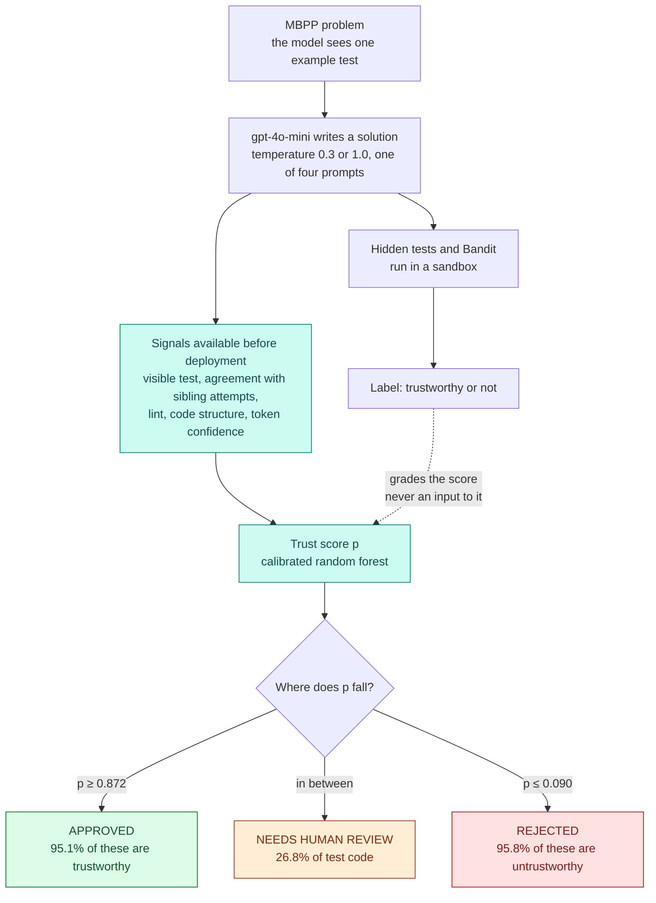

# Goal, approach, and what Cohen's kappa means

A plain account of TrustGate: what we set out to do, how a solution moves through the gate, what temperature means, how the work actually proceeded, and how to read the human-review number.

The full write-up, with tables, is `project_report.md`. Short answers on training, the models we tried, and the human review are in `faq.md`.

## The goal

Agents write code faster than a person can review it. The usual check is "did it pass the example I showed it?" We wanted a gate that can do better than that, using only information you would have before deploying the code.

For each AI-written solution the gate chooses one of three actions:

- **APPROVED**, merge it automatically
- **REJECTED**, throw it out automatically
- **NEEDS HUMAN REVIEW**, a person looks at it

The target for the two automatic actions was **95% precision**. At least 95% of approved code should really be trustworthy, and at least 95% of rejected code should really be untrustworthy. The uncertain middle goes to a person.

"Trustworthy" here is a measured fact, not an opinion: the solution passes every hidden test, and Bandit finds no medium or high security issue. Those hidden tests are used only to grade the gate. The model never sees them.

## How a solution moves through the gate

The solid arrows are what the gate uses on a new solution. The dashed arrow is the grade: we know the right answer only because we ran the hidden tests, and that answer is how we train and score the gate.

## What temperature means in ChatGPT

ChatGPT does not write a whole answer at once. It picks the next small piece of text, called a token, then the next, until the answer is finished. At every step the model has a probability for each token it might write next. "def" might be very likely, "return" a bit less, and a strange word almost not at all.

Temperature is the knob that decides how strictly it follows that ranking. It is a setting on the API and in tools that expose it, such as the OpenAI Playground. The everyday ChatGPT box often hides the knob and chooses for you. In this project we set it ourselves.

- **Low temperature, close to 0.** The model almost always takes the most likely next token. Ask the same question twice and you get nearly the same function. The writing is steady, and it repeats its favourite patterns.
- **Temperature 1.** The model samples the way it was trained: likely tokens come up often, unlikely ones sometimes. Two answers to the same problem can differ.
- **Above 1.** Unlikely tokens get a bigger share of the draw. The text wanders, invents odd names, and makes more mistakes. We did not use this.

A useful picture: temperature flattens or sharpens the list of chances. Lower means the top choice towers over the rest. Higher means the top choice is only a bit ahead, so a coin-flip among several reasonable next words becomes possible.

We generated every problem at **0.3** and at **1.0**, five times each. The trustworthy rate moved by less than one percentage point. Turning the randomness up did not produce a useful new crop of failures. Changing the wording of the prompt did: dropping the example test cut the trustworthy rate from about 74% to 55%. Temperature was the setting we expected to matter, and the data said the prompt mattered more.

## The approach

1. **Problems.** We started from SWE-Bench (real GitHub issues) and moved to MBPP, about a thousand small Python problems, because MBPP can be generated and graded in bulk. Each problem shows the model one example test. The rest of the tests stay hidden.
2. **Generate a lot of code.** `gpt-4o-mini` wrote five solutions for every problem under eight settings: two temperatures (0.3 and 1.0) and four ways of asking (standard, constrained, step by step, and signature only). That is 968 problems and 38,720 solutions, about $2.40. Every answer is saved, so nothing has to be generated again.
3. **Label by running the code.** Each solution runs in a sandbox. The label is pass-all-hidden-tests and no serious security finding. Lint and code shape are recorded, but they do not decide the label.
4. **Learn a score without the hidden tests.** Features are things you can know up front: did it pass the visible example, do other attempts at the same problem behave the same way, lint and security counts, code structure, and the model's own token confidence. A random forest turns those into a probability. Training, calibration, and test each use different problems, so the test is on problems the model has never seen.
5. **Turn the score into the three actions.** Two cutoffs on the probability decide approve, review, and reject. They are chosen on a calibration set of problems and then checked on a held-out test set.
6. **Ask a person.** A sample of solutions was reviewed blind, without looking at the automated label first. Cohen's kappa, explained below, says whether those labels match human judgment.

## How the solution was built, one run at a time

Each run answered a question the previous run could not.

| Step | What we ran | What we learned | What we changed |
| --- | --- | --- | --- |
| 1. Smoke test | 60 problems, no AI. Correct solutions plus copies with one planted bug. | The pipeline runs from start to finish. | Nothing about the science. This only proved the code works. |
| 2. First pilot | 20 problems, 200 solutions, one prompt style. | 76% trustworthy and **no** silent failures. Too easy. A model can look perfect on data that never fails in an interesting way. | Add more problems and more ways of prompting. |
| 3. Second pilot | 100 problems, four prompt styles, 4,000 solutions. | Silent failures appear: 5.9% of code that passes the example still fails the hidden tests. The trust model ranks code better than the example test alone. We also found a bug: step-by-step answers were appending their own tests, and those tests were being executed. | Strip any tests the model wrote, then relabel from the saved answers. No new API cost. |
| 4. Full run | All 968 problems, 38,720 solutions, about 4 hours 45 minutes. | The same pattern at scale, and stronger. Silent failures rise to 10.6% of visible-test passes. Test AUROC is 0.941 against 0.856 for "trust the example." | Keep this dataset. It is the one the report uses. |
| 5. Relabel after the fix | Rebuild, retest, and retrain from the cache. | Step-by-step crashes fall from 776 to 179. The ranking holds (AUROC 0.941). The approve cutoff, tuned on the calibration rows all together, only reaches **92.6%** precision on new problems. The 95% target is missed. | Leave the model. Fix the cutoff next. |
| 6. Human review | 164 solutions, reviewed blind. | Agreement 88.4%, kappa **0.738**. The labels are credible. The reviewer still approved about one in three wrong-output solutions, which is why a person reading code is not enough on its own. | Keep the execution labels. Do not train on the review. |
| 7. Decision rule | Choose the cutoffs so every held-out group of calibration problems still hits 95%. | On the unseen test problems, approval precision is **95.1%** and rejection precision is **95.8%**. The cost is more human review: 26.8% of test code, up from 9.3%. | This is the deployed gate: approve if p ≥ 0.872, reject if p ≤ 0.090, otherwise a person looks. |

The iteration was always the same shape. Run on saved data, read where the number fails, change one thing, measure again. After the full generation, every later step reused `generations.jsonl` and spent nothing on the API.

## The test results: recall, precision, and AUROC

These three are for the trust model on the 194 problems it never saw. Precision and recall use a probability cutoff of 0.5: predict trustworthy when p ≥ 0.5. AUROC does not use one cutoff. It asks whether trustworthy solutions are scored higher than untrustworthy ones, across every cutoff. Brackets are 95% intervals from resampling the test problems.

| Metric | Trust model | Visible-test-only baseline |
| --- | --- | --- |
| **AUROC** | **0.941** [0.910, 0.968] | 0.856 |
| **Precision** | 0.892 [0.849, 0.934] | 0.872 |
| **Recall** | 0.956 [0.929, 0.977] | 0.964 |

Reading the row: when the model says "trustworthy" at 0.5, it is right 89.2% of the time (precision). It finds 95.6% of the solutions that really are trustworthy (recall). Its ranking is well above the example-test rule, whose AUROC of 0.856 sits outside the model's whole interval.

The **95% target is a different precision.** It is not this 0.892. It is the precision of the gate after the cutoffs: of the code it approves, 95.1% is trustworthy, and of the code it rejects, 95.8% is untrustworthy. That gate approves only when p ≥ 0.872, which is stricter than 0.5, so precision goes up and some trustworthy code is sent to review instead of being approved.

## What is in the label, and what is not

The label is one bit per solution. It is 1 only when **both** of these are true:

- the solution **passes every hidden test**
- Bandit reports **no medium or high** finding

Everything else is kept out of the label.

| Used in the label | Recorded, but not the label |
| --- | --- |
| Hidden-test outcome (pass, wrong output, crash, timeout, syntax error) | The visible example test. It is a feature. The model is allowed to see it. |
| A medium or high Bandit finding flips the label to 0 | Ruff lint counts, code size, complexity, and the other Bandit counts. These are features. |
| | Agreement with sibling attempts, and the model's token confidence. Features. |
| | The human review. It checks the label with kappa. It is never a training target. |
| | Which prompt or temperature produced the code. |

The hidden-test details (`exec_status`, how many hidden tests passed, the error text) are blocked from the feature list, so the model cannot be trained on the answer key. The medium/high Bandit flag is the exception: it is part of the label and it is also a feature. On this dataset that flag is almost always zero, and the model does not use it.

## What Cohen's kappa means

Kappa measures how often two judges agree, after taking away the agreement you would get by luck. In this project the two judges are:

- the automated label, from the hidden tests and Bandit
- the human review of 164 solutions, done blind

They gave the same yes or no on **88.4%** of rows (145 of 164). That percentage looks high partly because most solutions really are trustworthy, so both judges often say "yes" even when they are not paying attention to each other. Kappa removes that luck.

κ = (agreement we observed − agreement expected by chance) / (1 − agreement expected by chance)

- **0** means the two judges agree only as often as chance.
- **1** means they agree every time.

Our kappa is **0.738**, and the 95% interval is **[0.62, 0.84]**. From 0.61 to 0.80 is called substantial agreement. The project had set 0.60 as the bar for trusting the labels, and 0.738 clears it.

The gap between 88.4% and 0.74 is where the two judges actually part ways, and those cases are the informative ones:

- The reviewer said yes and the tests said no on **16** solutions. Most of them returned the wrong answer but looked plausible when read.
- The reviewer said no and the tests said yes on **3** solutions. The reviewer's own extra checks failed. Those point to noisy or overly strict benchmark tests.

So the labels are good enough to train and evaluate on. They are not perfect, and a person reading code still misses failures that running the tests catches.
